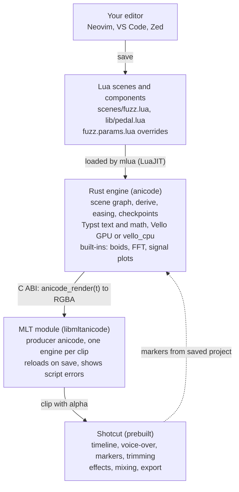

# Anicode — Code-First Animation Engine for Shotcut: Build Plan

Nov 14, 2026

## Goals and scope

The app is a code-first animation engine, working name **Anicode**. You write scenes in Lua, a Rust engine renders them, and they appear as ordinary clips inside the prebuilt Shotcut, timed against your voice-over on Shotcut's timeline. Everything else (cutting, audio, effects, export) stays in Shotcut, with DaVinci as an optional finishing step.

**Goals**

- Scenes are plain, readable Lua: objects, functions and classes, the way you'd write Manim. No config files and no DSL.
- Rust provides the primitives: shapes, paths, text, math (via Typst), SVG, images, groups, plus heavy built-ins like boids, FFT and plots. Lua composes them into reusable components.
- Timing is driven by named markers you line up with the voice-over, so there are no freeze frames or manual re-cutting.
- Live preview: save the `.lua` file and Shotcut shows the change, and you can scrub to any frame without replaying from the start.
- Runs on macOS (Apple Silicon, Metal) and Debian (Vulkan or CPU).

**Non-goals for v1**

- No fork or rebuild of Shotcut. Only the prebuilt app plus a plugin.
- No built-in code editor. Your own editor sits beside Shotcut.
- No 3D, no node-based compositing, no video decoding inside the engine. Footage stays on Shotcut's timeline.

**Success criteria**

- One complete video, for example the guitar-pedal episode, made end to end with no freeze-frame workarounds.
- Typical edit-to-preview time under 1 s, and seeking any frame of a 2-minute scene under 100 ms.
- The same project renders the same pixels on macOS and Debian, within the golden-frame tolerance.

## Architecture

The app has four layers, each written in the language that suits it. Only two boundaries cross languages: Lua to Rust through mlua, and Rust to MLT through one C call per frame.



Shotcut never runs Lua. It asks the plugin for frame $t$, and marker times flow back to the engine through the saved project file.

## Lua scene API

A scene is a single `.lua` file that builds objects once, then attaches animations to named markers. Lua only holds **handles**. Rust owns every object, so a scene can't leave a dangling reference or corrupt memory.

**Primitives (implemented in Rust)**

| Primitive | Purpose | Key options |
| --- | --- | --- |
| `Rect`, `Circle`, `Line`, `Polygon`, `Arrow` | basic shapes | size, fill, stroke, radius |
| `Path` | Bézier paths, morph targets | points, closed, stroke |
| `Text` | plain text in your fonts | size, font, weight |
| `Math` | equations, via Typst | Typst math source |
| `Code` | syntax-highlighted code | language, theme, highlighted lines |
| `SVG`, `Image` | imported assets | path, size |
| `Group` | transform hierarchy | children |
| `Boids`, `FFT`, `Plot` | heavy built-ins | depend on the built-in |

**Core functions**

| Function | What it does |
| --- | --- |
| `at "name" { ... }` | starts these animations at marker `name`; each lasts `default_animation_seconds` (1 s) unless it has `:over(seconds)` |
| `play { ... }` | an unnamed step: starts where the previous block ends. Steps are numbered 1, 2, 3 for markers |
| `seconds = n` inside `at` or `play` | how long the block lasts before the next one. Default: `default_block_seconds` or its longest animation, whichever is longer |
| `shift`, `scale`, `rotate` | function forms of the node methods, for use inside `play` (a method there would change the value right away) |
| `param("name", default)` | a value you can override from the project without editing code |
| `animate(value, target)` | tweens a property; chain `:over(seconds)`, `:ease("inout")` |
| `fade_in`, `fade_out`, `write`, `morph`, `move_to` | the common Manim-style animations |
| `derive(fn)` | a property computed from other properties each frame; replaces Manim updaters |
| `require "module"` | loads your component library |

**Components (written in Lua)**

A component is a Lua function or class that creates primitives inside a `Group` and connects them with `derive`. It doesn't exist on the Rust side, so you can write new ones freely without rebuilding anything.

```lua
-- lib/pedal.lua
local Pedal = {}
function Pedal.new(opts)
  local self = Group {}
  self.body  = self:add(Rect { w = 3, h = 4.5, radius = 0.2, fill = opts.color })
  self.label = self:add(Text { opts.name, size = 0.4 }):below(self.body, 0.2)
  self.knobs = {}
  for i, name in ipairs(opts.knobs) do
    local k = self:add(Knob.new { label = name })
    k:move_to(self.body:top() + vec((i - 2) * 0.9, -0.8))
    self.knobs[name] = k
  end
  self.led = self:add(Circle { r = 0.12, fill = RED })
  self.led.opacity = derive(function() return self.knobs.level.value end)
  return self
end
return Pedal
```

```lua
-- scenes/fuzz.lua
local Pedal = require "pedal"
local fuzz  = Pedal.new { name = "FUZZ", color = ORANGE, knobs = {"gain", "tone", "level"} }
local eq    = Math { "y(t) = tanh(g dot x(t))" }:next_to(fuzz, RIGHT)

at "intro"     { fade_in(fuzz) }
at "transfer"  { write(eq) }
at "turn_gain" { animate(fuzz.knobs.gain.value, param("gain_end", 0.9)):over(1.5) }
at "zoom"      { fuzz:scale(2):shift(LEFT * 3) }
```

The Lua runtime is **LuaJIT**, which is fast enough for simulations written in script. Luau is a drop-in alternative if you later want optional type checking; mlua supports both.

## Rust engine

The engine is a Cargo workspace. One crate builds a C-ABI library for MLT, and another builds a standalone CLI so the engine can be developed and tested without Shotcut.

| Crate | Responsibility | Main dependencies |
| --- | --- | --- |
| `anicode-core` | scene graph, handles, properties, easing, timeline evaluation, `derive` resolution | `glam`, `kurbo` |
| `anicode-lua` | Lua bindings: primitives, `at`, `param`, `animate`; error tracebacks with line numbers | `mlua` (LuaJIT, vendored) |
| `anicode-render` | turns a frame's scene into pixels; GPU and CPU backends behind one trait | `vello`, `vello_cpu`, `wgpu` |
| `anicode-text` | text and math layout to vector paths | `typst` (as a library), `parley` or Typst's text stack |
| `anicode-assets` | SVG, image loading, caching | `usvg`, `image` |
| `anicode-builtins` | boids, FFT, signal plots, other heavy sims | `rustfft` |
| `anicode-ffi` | `cdylib` with the C functions MLT calls | none |
| `anicode-cli` | `anicode render scene.lua --frames 0..300 --out frames/`, plus a preview window | `winit`, `clap` |

**Evaluation model.** Every frame is a pure function of time, markers and params, so any frame can be rendered directly without replaying the frames before it:

$$
S(t) = f\big(\text{scene},\ \{m_i\},\ \{p_j\},\ t\big)
$$

An animation that starts at marker $m_i$ and lasts $d$ seconds (from `:over`, or the configured default) sees local progress $u$, which an easing curve then reshapes. Markers only set start times, so markers placed together still animate:

$$
u = \operatorname{clamp}\!\left(\frac{t - m_i}{d},\ 0,\ 1\right)
$$

Per frame, the engine (1) sets animated values for $t$, (2) resolves `derive` properties in dependency order, failing loudly on cycles, and (3) renders.

**Stateful simulations.** Boids and similar built-ins break the pure-function rule. They store a checkpoint every $k$ frames, so a seek re-runs at most $k$ steps:

$$
S(t) = \text{step}^{\,t - t_c}\big(S(t_c)\big), \qquad t_c = k \left\lfloor t / k \right\rfloor
$$

Simulations step at a fixed rate and use a seeded RNG, so every render of a frame matches.

**Rendering backends.** `vello` on the GPU through `wgpu` (Metal on macOS, Vulkan on Debian) for export and heavy scenes. `vello_cpu` for scrubbing and golden-frame tests, and as the fallback when no compatible GPU is present. Both draw the same scene description.

**Caching.** Typst layouts and SVG parses are cached by content hash. Static subtrees (nothing animated inside) are cached as encoded scene fragments. On reload, only the Lua file re-runs; caches survive when inputs haven't changed.

## MLT plugin and Shotcut integration

The plugin is a small MLT module (`libmltanicode`, written in C) that registers a producer called `anicode`. Shotcut sees each scene as an ordinary video clip with an alpha channel. All engine logic stays in Rust behind five C functions.

**C interface (`anicode.h`)**

```c
typedef struct anicode_engine anicode_engine;

anicode_engine *anicode_open(const char *scene_path, int width, int height, double fps);
int          anicode_reload_if_changed(anicode_engine *e);           /* 1 = reloaded, -1 = script error */
void         anicode_set_overrides(anicode_engine *e, const char *json); /* markers + params */
int          anicode_render(anicode_engine *e, double t, uint8_t *rgba, int stride);
const char  *anicode_last_error(anicode_engine *e);                   /* file:line: message */
void         anicode_close(anicode_engine *e);
```

Rules for this boundary:

- Rust catches every panic (`catch_unwind`) and returns an error code. Nothing unwinds into MLT or Shotcut.
- The engine owns all memory. MLT only lends the frame buffer for the duration of `anicode_render`.
- One engine per clip instance, and engine handles are not shared across threads.

**Producer behaviour**

1. `resource` names the scene file. Width, height and fps come from the MLT profile, so the scene always matches the project.
2. On each `get_frame`, the producer calls `anicode_reload_if_changed`, which checks the file's modification time. Edits therefore appear on the next frame Shotcut requests. Milestone 0 showed that Shotcut does not redraw by itself while paused, so you step a frame (or scrub) to see the change. M3 tests whether the producer can make Shotcut redraw.
3. It returns premultiplied RGBA. Shotcut composites it over footage or a background on the track below.
4. On a script error it keeps showing the last good frame with a red banner that reads `scene.lua:42: attempt to index nil`, so an error never blanks the timeline.
5. The clip's length comes from the scene's last marker. You can still trim it on the timeline.

**How a scene gets into prebuilt Shotcut.** Shotcut opens `.mlt` XML files as clips. `anicode new fuzz` writes a three-line wrapper beside the scene, and you drag that wrapper onto the timeline:

```xml
<mlt><producer id="fuzz" mlt_service="anicode">
  <property name="resource">scenes/fuzz.lua</property>
</producer></mlt>
```

**Plugin install location.** On Debian with the distro Shotcut, the plugin goes in the system MLT module directory, and it matches automatically because Shotcut links the system MLT. On macOS the signed `Shotcut.app` (26.9.28) bundles its own MLT 7.41 and only loads modules from its own `Contents/PlugIns/mlt` folder. It ignores `MLT_REPOSITORY` and `MLT_APPDIR`. Milestone 0 settled on a development copy of the app instead (see below).

**macOS development copy.** Shotcut is signed with `disable-library-validation`, so it loads unsigned modules once they are inside the bundle. Adding a file breaks the bundle signature, so the copy is re-signed locally. Redo these steps after each Shotcut update:

```sh
ditto /Applications/Shotcut.app ~/Applications/Shotcut-Anicode.app
xattr -dr com.apple.quarantine ~/Applications/Shotcut-Anicode.app
ln -sf "$PWD/build/libmltanicode.so" ~/Applications/Shotcut-Anicode.app/Contents/PlugIns/mlt/
codesign --force --deep --sign - --preserve-metadata=entitlements,flags ~/Applications/Shotcut-Anicode.app
```

The module is a symlink to the build output, so rebuilding needs no re-signing. `codesign --verify --strict` rejects the symlink because it points outside the bundle, but the app runs. The module is linked with `-undefined dynamic_lookup` on macOS, so it uses Shotcut's MLT and never loads a second copy.

## Timing and the editing workflow

Timing is set by Shotcut timeline markers placed against the voice-over waveform. Code only names the markers, so re-timing an animation means dragging a marker, not editing code or cutting frames.

**Where marker times come from.** Shotcut stores timeline markers in the project's `.mlt` file. Each scene wrapper names the project (`anicode.project`). When you save in Shotcut, the engine re-reads that file, finds its own clip, and converts each marker named `fuzz:intro`, `fuzz:transfer` and so on into clip-local time:

$$
m_i^{\text{clip}} = m_i^{\text{timeline}} - \text{clip position} + \text{clip in-point}
$$

If a scene names a marker that doesn't exist yet, the engine falls back to a default spacing (2 s per block) and lists the missing markers in the error banner. That way a first draft plays before any timing work.

**Params.** `param("gain_end", 0.9)` takes its default from code. Overrides live in `fuzz.params.lua`, a plain Lua table, so no YAML or XML enters the project. Changing an override reloads the frame just like a code edit.

**Daily loop**

1. Record the voice-over and drop it on Shotcut's audio track.
2. Write `scenes/fuzz.lua` in your editor, run `anicode new fuzz`, and drag the wrapper onto the video track.
3. Add Shotcut markers `fuzz:intro`, `fuzz:transfer` and so on at the words they belong to, then save the project.
4. Edit code or params. Each save refreshes Shotcut's preview at the current frame.
5. Scrub and adjust markers until it lands. Cut, mix and add effects in Shotcut as usual.
6. Export from Shotcut, or export ProRes 4444 with alpha for finishing in DaVinci.

**Stretch: word anchors.** Shotcut's speech-to-text can produce a subtitle track from the voice-over. A later version can let a scene anchor to a spoken word, `at(word "tanh")`, read from the exported subtitles, and skip manual markers for most cues.

## Platforms and build

Both platforms are first-class. The only real difference is how the plugin gets into Shotcut.

| Area | macOS (Apple Silicon) | Debian |
| --- | --- | --- |
| GPU backend | `wgpu` on Metal | `wgpu` on Vulkan (Mesa for AMD/Intel, NVIDIA driver) |
| CPU fallback | `vello_cpu` | `vello_cpu` |
| GPU-to-CPU frame copy | cheap: unified memory | over PCIe on discrete GPUs, about 0.5 GB/s at 1080p60 |
| Lua | LuaJIT via mlua `vendored`; build with `MACOSX_DEPLOYMENT_TARGET` set | LuaJIT via mlua `vendored` |
| MLT headers to build against | `brew install mlt` | `apt install libmlt-dev libmlt++-dev melt` |
| Shotcut | official signed universal app | distro package: trixie ships 25.03; forky or sid ships 26.x |
| Plugin location | re-signed copy of Shotcut.app, module symlinked into `Contents/PlugIns/mlt` | system MLT module directory |
| Hardware video encode | VideoToolbox, inside Shotcut | VAAPI or NVENC, inside Shotcut |

Keep Shotcut's own GPU effects switched off on macOS. They rely on OpenGL, which Apple has deprecated, and Anicode doesn't need them.

**Toolchain.** Rust stable through `rustup`. A C compiler for the 200-line MLT module. CMake with Corrosion, so `cmake --build build` compiles the Rust workspace and the C module together. No Qt and no Shotcut source.

**Repository layout**

```
anicode/
  crates/
    anicode-core/  anicode-lua/  anicode-render/  anicode-text/
    anicode-assets/  anicode-builtins/  anicode-ffi/  anicode-cli/
  mlt-module/          # C: producer_anicode.c, factory.c, anicode.yml
  lua/stdlib/          # animations and helpers written in Lua
  examples/            # fuzz.lua, boids.lua, lowpass.lua
  tests/golden/        # reference frames
  CMakeLists.txt
```

**CI.** GitHub Actions on `macos-latest` (arm64; `macos-14` is retired) and a Debian container: build, unit tests, golden frames on `vello_cpu`, and a `melt` smoke render of each example.

## Milestones

A usable v1 takes about 15 weeks part-time. The first two weeks only prove the plugin can load in prebuilt Shotcut, because everything else depends on that.

```mermaid
flowchart TD
    M0["<b>M0 Spike</b> · weeks 1–2<br/>Stub MLT module that draws a test pattern<br/>Load it in prebuilt Shotcut on macOS and Debian<br/>Confirm Shotcut re-requests frames after a file change"]
    G0{{"Gate: plugin path chosen<br/>(direct load, MLT_REPOSITORY, or proxy fallback)"}}
    M1["<b>M1 Engine core</b> · weeks 3–6<br/>anicode-core and anicode-lua: handles, groups, at, animate, derive<br/>Shapes and paths rendered with vello_cpu<br/>anicode-cli renders PNG frames; golden-frame tests in CI"]
    G1{{"Gate: golden frames pass on macOS and Debian"}}
    M2["<b>M2 Content</b> · weeks 7–9<br/>Text and math via Typst, Code, SVG, Image<br/>morph, write, Lua components, params files<br/>GPU path via wgpu on Metal and Vulkan"]
    G2{{"Gate: fuzz.lua renders a 1080p frame in under 16 ms on the GPU path"}}
    M3["<b>M3 Shotcut</b> · weeks 10–12<br/>Full producer: alpha, reload on save, error banner<br/>Marker times read from the saved Shotcut project<br/>anicode new writes the .mlt wrapper for each scene"]
    G3{{"Gate: moving a marker in Shotcut re-times the animation"}}
    M4["<b>M4 First video</b> · weeks 13–15<br/>Built-ins: boids with checkpoints, FFT, signal plots<br/>Make one full episode end to end<br/>Fix whatever slowed you down while making it"]
    G4{{"Gate: an episode exported with no freeze-frame workarounds"}}
    AV["<b>After v1</b><br/>Word anchors from subtitles, own preview window, Luau types"]
    M0 --> G0 --> M1 --> G1 --> M2 --> G2 --> M3 --> G3 --> M4 --> G4 --> AV
```



Each phase ends at a gate you can check yourself. If M0 lands on the proxy fallback, M3 becomes a file watcher that re-renders a ProRes proxy, and the other phases don't change.

**M0 result (Nov 14, 2026).** Gate passed without the proxy fallback. On macOS the plugin loads in a re-signed copy of Shotcut 26.9.28 and draws the test pattern. On Debian trixie (MLT 7.30) it builds and renders with `melt` in CI; the Shotcut window on Linux is not tested yet. After a save, Shotcut shows the new frame on the next scrub or play, but does not redraw while paused.

## Risks and open questions

The biggest risk is the macOS plugin path, so Milestone 0 tests it before any engine work.

| Risk | Likelihood | Impact | Mitigation |
| --- | --- | --- | --- |
| Signed Shotcut.app on macOS won't load an outside MLT module | resolved in M0 | high | Confirmed: it only loads from its own bundle, and Fallback 1 does not work. Use the re-signed copy described above. Original plan: Fallback 1: launch Shotcut with `MLT_REPOSITORY` pointing to a merged module folder. Fallback 2: `anicode watch` renders a ProRes 4444 proxy on every save and Shotcut reloads the proxy clip. Slower, but it needs no plugin. |
| MLT version drift between the plugin and Shotcut's bundled MLT | medium | medium | Build against the same MLT 7.x minor version Shotcut ships. Check the version at module load and show a clear error. |
| Reading markers from the saved project file is fragile | medium | medium | Treat the project file as read-only input, and parse defensively. Fallback: a `fuzz.markers.lua` table edited by hand. |
| Preview too slow when scrubbing dense scenes | low | medium | Use `vello_cpu` for preview at half resolution and the GPU path for export. Cache static subtrees. |
| GPU readback latency on Debian with a discrete GPU | low | low | Copy back asynchronously, or use `vello_cpu` for preview. |
| Vello and Typst APIs change between releases | high | low | Pin versions in `Cargo.lock`. Wrap both behind `anicode-render` and `anicode-text` so changes stay inside one crate. |
| Lua `derive` cycles or slow per-frame closures | medium | low | Detect cycles at load. Move hot loops into Rust built-ins. |
| GPL obligations from Shotcut | low | low | No impact: Anicode never links Shotcut code, and MLT is LGPL. |

**Open questions**

- Does Shotcut re-request frames from a producer when the file changes on disk, or does Anicode need to signal it? Answered in M0: it only re-requests on scrub or play, so Anicode needs to signal it. Still open: whether firing an MLT event from the producer makes Shotcut redraw. Test this in M3.
- Should the engine have its own preview window, using `anicode-cli`, for quick looping without Shotcut? It's cheap to keep.
- Audio cues from scenes (whooshes and clicks): put them on Shotcut's timeline by hand, or have Anicode export marker-aligned cue files?

## Testing and verification

Every feature lands with a golden-frame test, because frames are pure functions of time and are cheap to check.

| Test | What it checks | Runs |
| --- | --- | --- |
| Golden frames | render chosen frames of each example with `vello_cpu`, compare to reference PNGs (per-pixel tolerance) | every commit, both OSes |
| Seek consistency | frame $t$ rendered directly matches frame $t$ reached by playing from 0, including boids checkpoints | every commit |
| Lua API | each primitive, animation and `derive`; error messages carry the right file and line | every commit |
| FFI | open, reload, render and close under a thread sanitizer; bad scene paths and script errors never crash | every commit |
| Performance | 1080p frame time on the examples stays under 16 ms on the GPU path and 60 ms on the CPU path | weekly, on your Mac |
| MLT smoke | `melt examples/fuzz.mlt` renders 300 frames to a file | every commit |
| Shotcut manual | drag the wrapper in, edit, scrub, move a marker, export | at each milestone gate |

## Sources

- [MLT framework](https://mltframework.org/) and [features](https://mltframework.org/features/)
- [Shotcut release notes](https://shotcut.org/download/releasenotes/), [FAQ](https://shotcut.org/FAQ/), [23.05 notes on Metal and universal builds](https://shotcut.org/blog/new-release-230507)
- [Shotcut macOS build thread](https://forum.shotcut.org/t/link-to-osx-sdk-is-broken/47171)
- [Debian MLT packages](https://tracker.debian.org/media/packages/m/mlt/control-7.36.1-1), [Debian Shotcut versions](https://sources.debian.org/patches/shotcut)
- [Vello](https://docs.rs/crate/vello/0.10.0), [Vello Hybrid](https://docs.rs/vello_hybrid), [wgpu backends](https://lib.rs/crates/wgpu-core-deps-apple/features)
- [LuaJIT status](https://luajit.org/status.html), [Homebrew MLT](https://formulae.brew.sh/formula/mlt)
- [motion-canvas-rs: Vello and Typst reference](https://docs.rs/crate/motion-canvas-rs/0.1.3), [ranim](https://docs.rs/crate/ranim/0.1.3)
- [Typst comemo incremental design](https://laurmaedje.github.io/posts/comemo)
